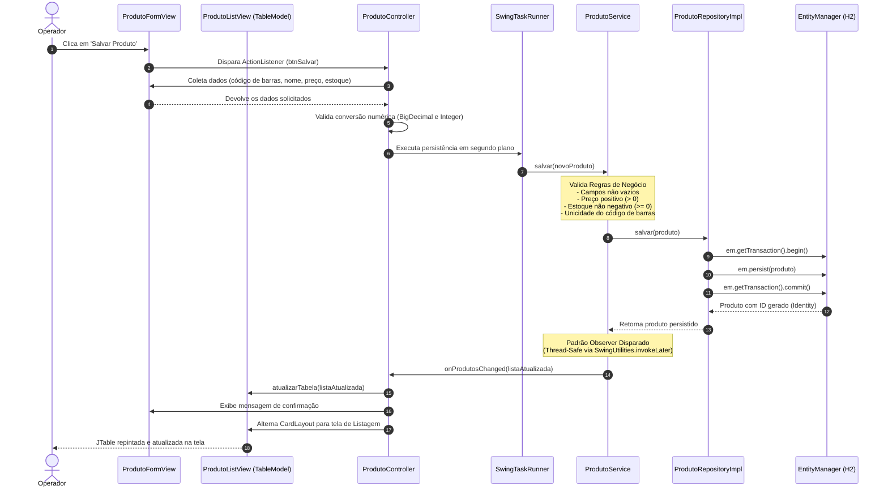
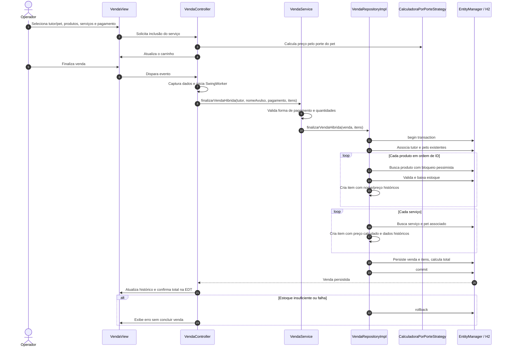
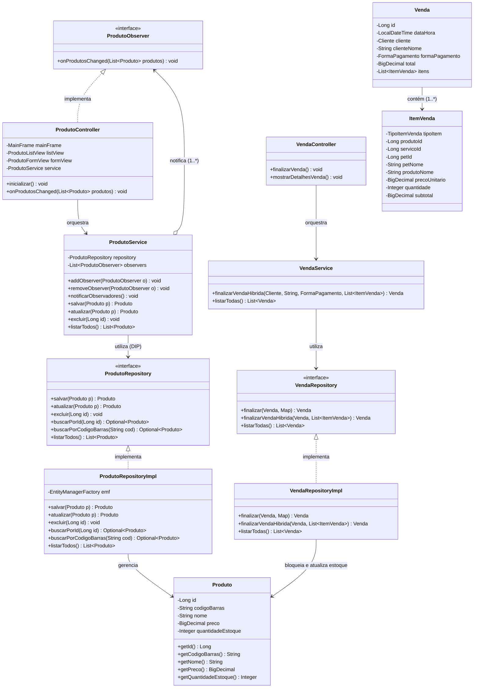
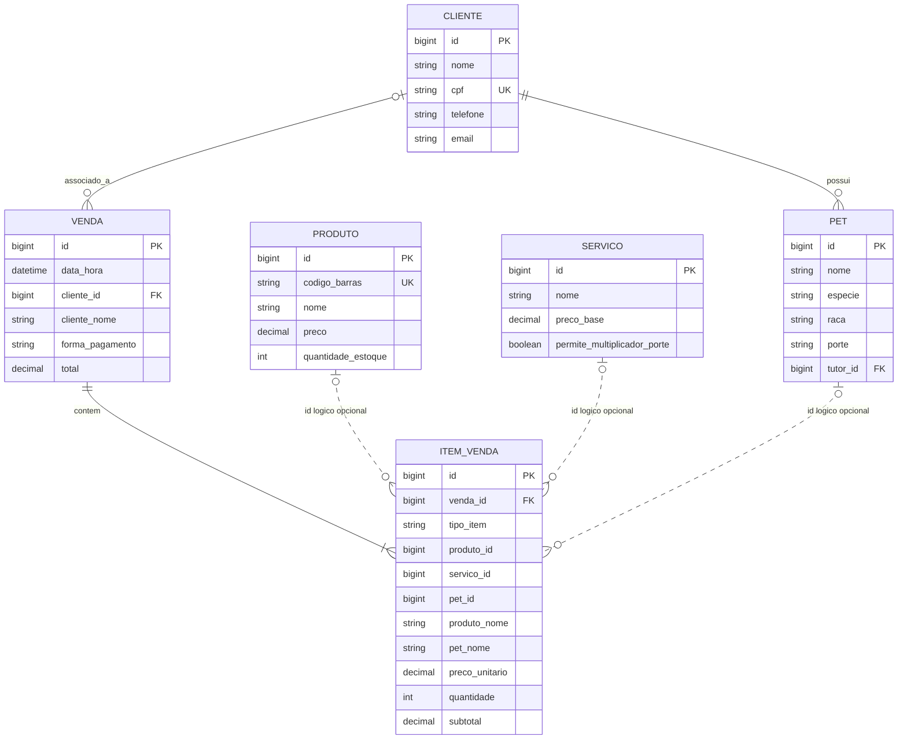
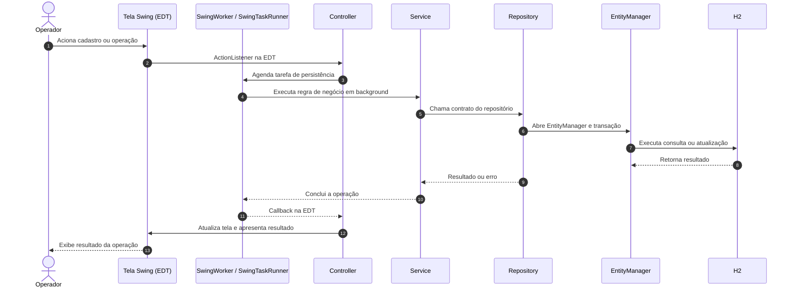

# PetPDV-Swing-JPA: Sistema de Ponto de Venda para Pet Shop & Clínica Veterinária

> **Plano de Aula & Projeto Didático de Referência para Ensino Superior**  
> **Docente:** Prof. Cainã Antunes Silva  
> **Disciplina:** Técnicas de Programação II  
> **Tema da Aula:** Persistência de dados utilizando frameworks de interface gráfica  
> **Duração:** 50 minutos  

## Visão rápida

O **PetPDV** é um protótipo didático de ponto de venda para pet shop e clínica veterinária. A aplicação desktop usa Java Swing, persiste os dados localmente em H2 por meio de JPA/Hibernate e demonstra como organizar uma aplicação com MVC, Repository, Observer e Strategy.

| Item | Informação |
| :--- | :--- |
| Linguagem | Java 17 |
| Interface | Java Swing com FlatLaf |
| Persistência | Jakarta Persistence 3.1 / Hibernate 6 |
| Banco principal | H2 em arquivo local (`data/pdv_db.mv.db`) |
| Banco de testes | H2 em memória (`pdv-test-pu`) |
| Execução | Maven Wrapper (`mvnw` / `mvnw.cmd`) |
| Escopo | Demonstração acadêmica; não é uma instalação pronta para produção |

O sistema cobre cadastro de produtos, tutores, pets e serviços, além de vendas híbridas com histórico e controle transacional de estoque. As formas de pagamento são registradas, mas não processadas por adquirentes. O projeto não emite documentos fiscais.

**Atalho para começar:** com JDK 17 instalado, execute `.\mvnw.cmd test` e depois `.\mvnw.cmd compile exec:java` no Windows. Instruções para Linux/macOS, empacotamento, testes e limitações estão nas seções abaixo.

---

## 1. Identificação e Contextualização do Plano de Aula

Este projeto materializa um protótipo didático de **Pet Shop & Clínica Veterinária (PetPDV)** em **Java Swing**, com persistência relacional por **JPA 3.1 / Hibernate 6** e banco embutido **H2 Database**. Inclui venda híbrida de produtos (com controle e baixa atômica de estoque) e serviços, gestão de tutores (clientes) e animais de estimação, formas de pagamento, histórico e precificação dinâmica. A arquitetura demonstra **MVC, Observer, Repository, Strategy (GoF) e Inversão de Controle**.

### 1.1. Pré-Requisitos Curriculares
Para acompanhar esta aula, considera-se que os estudantes dominam competências consolidadas em semestres anteriores e em tópicos inaugurais desta disciplina:
- **Técnicas de Programação I (2º Semestre):** Conceitos fundamentais de Programação Orientada a Objetos (classes, encapsulamento, herança, polimorfismo, contratos de interface), tratamento de exceções e introdução à construção de interfaces gráficas.
- **Banco de Dados Relacional (2º Semestre):** Modelagem conceitual, lógica e física; integridade referencial e manipulação de dados com linguagem SQL (DDL e DML).
- **Técnicas de Programação II (Aulas Anteriores):** Fundamentos dos padrões de projeto GoF (criacionais, estruturais e comportamentais) e introdução aos padrões arquiteturais de interface com usuário (MVC, MVP e MVVM).

---

## 2. Objetivos de Aprendizagem

Ao término desta aula de 50 minutos, os discentes deverão atingir os seguintes objetivos educacionais:

### 2.1. Objetivos Cognitivos (Saber)
- **Compreender** como frameworks de interface gráfica orquestram a persistência de dados por meio da Inversão de Controle (*Inversion of Control* / *Hollywood Principle*) e da arquitetura orientada a eventos.
- **Identificar** o papel das ferramentas de Mapeamento Objeto-Relacional (ORM) na resolução do descompasso de impedância (*impedance mismatch*) e compreender como consultas parametrizadas reduzem riscos de injeção de SQL (*SQL Injection*).
- **Reconhecer** a aplicação prática dos padrões GoF *Observer* e dos padrões corporativos *MVC* e *Repository* em arquiteturas cliente desktop.

### 2.2. Objetivos Práticos / Procedimentais (Saber Fazer)
- **Conectar** a camada de apresentação visual construída em Java Swing a um repositório de dados mediado por JPA/Hibernate e banco de dados H2.
- **Implementar** a sincronização reativa de dados entre modelos de tabela (`AbstractTableModel`) e componentes visuais (`JTable`) utilizando eventos desacoplados do padrão *Observer*.

### 2.3. Objetivos Atitudinais (Ser / Agir)
- **Demonstrar pensamento crítico** na seleção e estruturação de camadas de software, valorizando boas práticas de código limpo, desacoplamento arquitetural e segurança da informação no ciclo de vida dos dados corporativos.

---

## 3. Conteúdo Programático

1. **Contexto de Persistência em Aplicações Gráficas:** A ação do usuário como gatilho do ciclo de vida dos dados; Inversão de Controle (IoC) em frameworks de GUI.
2. **Padrão Arquitetural MVC e Desacoplamento:** Fronteiras e contratos entre visualização (`View`), orquestração (`Controller`) e dados/regras de domínio (`Model`).
3. **Padrões de Projeto Aplicados ao Framework e à Persistência:**
   - **Observer (GoF):** `ActionListener` (captura na GUI) e `ProdutoObserver` / `fireTableDataChanged` (sincronização reativa de tela).
   - **Repository:** Contratos que isolam as operações JPA e o acesso ao banco das regras de negócio.
4. **Camada ORM (JPA/Hibernate) & Banco Embutido:** Mapeamento declarativo de entidades (`@Entity`, `@Table`, `@Id`), controle transacional atômico (`commit`/`rollback`) e execução segura de transações sobre o H2 Database.
5. **Fluxo de Venda:** Composição do carrinho, cálculo de total, registro de forma de pagamento e cliente opcional, histórico da venda e atualização transacional do estoque.
6. **Estudo de Caso Norteador:** Análise dos módulos de Produtos, Tutores/Pets, Serviços e Vendas do PDV.

### 3.1. Módulos e funcionalidades

| Módulo | Funcionalidades |
| :--- | :--- |
| **Produtos / estoque** | Cadastro, edição, listagem e exclusão; valida preço positivo, estoque não negativo e código de barras único. O saldo pode ser ajustado pela edição do produto. |
| **Tutores e pets** | Cadastro, edição e exclusão de tutores; inclusão e remoção de pets vinculados; espécie, raça, porte e observações. |
| **Serviços** | Cadastro, edição, listagem e exclusão; preço-base e opção de aplicar multiplicador conforme o porte do pet. |
| **Caixa / vendas** | Carrinho misto de produtos e serviços, tutor cadastrado ou cliente avulso, pet associado quando selecionado, forma de pagamento e confirmação da venda. |
| **Histórico** | Consulta de vendas anteriores e detalhes dos itens, quantidades, valores, tutor/cliente, pet(s) associados e forma de pagamento. |

### 3.2. Regras de negócio principais

- Produto exige código de barras e nome; o preço deve ser maior que zero e o estoque deve ser zero ou positivo.
- Tutor exige nome, CPF e telefone. O CPF deve ter 11 dígitos e verificadores válidos; aceita entrada com ou sem pontuação e é armazenado no formato `000.000.000-00`. Isso não confirma emissão nem titularidade do documento.
- Pet exige nome, raça, espécie e porte; o cadastro associa o animal a um tutor.
- Serviço exige nome e preço-base positivo. Serviços com ajuste por porte usam os multiplicadores `1,00`, `1,25`, `1,50` e `1,80` para portes pequeno, médio, grande e gigante.
- Venda exige forma de pagamento e pelo menos um item. Quantidades e valores unitários precisam ser positivos.
- Produtos têm o estoque verificado e decrementado na mesma transação que grava a venda e seus itens. Falha de estoque causa rollback; serviços não consomem estoque físico.
- Os itens guardam descrição, preço e, quando selecionado, o nome do pet no momento da venda, para que alterações futuras no cadastro não apaguem a associação exibida no histórico.
- Quando um tutor está selecionado, a persistência confirma que cada pet associado aos itens pertence a esse tutor. Essa checagem impede que uma troca de tutor com itens antigos no carrinho crie uma associação inconsistente; a venda nunca altera o vínculo tutor–pet.
- Inicialização não exclui produtos nem altera saldos existentes. Dados demonstrativos são inseridos apenas quando os respectivos cadastros estão vazios.

### 3.3. Roteiro de uso da aplicação

1. Abra **Tutores & Pets** para cadastrar um tutor e, em seguida, um pet com espécie e porte.
2. Em **Produtos (Estoque)**, cadastre produtos ou edite o saldo disponível.
3. Em **Serviços**, cadastre os serviços e defina se o preço varia conforme o porte.
4. Em **Caixa / Vendas**, selecione tutor e pet quando aplicável; adicione produtos, serviços e quantidades.
5. Selecione a forma de pagamento e finalize. O sistema apresenta o total, limpa o carrinho e atualiza o histórico.
6. Consulte a venda pelo histórico para apresentar tutor, pet(s) associados, itens e valores registrados. Se nenhum pet foi associado aos itens, o histórico informa que não há pet registrado.

Para demonstrar o rollback, prepare um produto com estoque menor que a quantidade solicitada e tente finalizar a venda. A operação deve ser recusada sem gravar a venda nem baixar parcialmente o estoque. Depois, ajuste o saldo na tela de produtos e repita o fluxo.

---

## 4. Estratégias Pedagógicas e Metodologia

A condução didática fundamenta-se na articulação entre o **Estudo de Caso Norteador**, a **Demonstração Conceitual Dirigida** e a **Aprendizagem Baseada em Projetos (PBL - Project-Based Learning)**:

- **Contextualização e Situação-Problema (Abertura):** A aula parte de uma demanda real do mercado de trabalho — o gerenciamento de retaguarda de produtos em um Ponto de Venda (PDV) — para instigar a reflexão sobre os vícios clássicos da programação desktop: mistura de comandos SQL dentro de eventos de clique de botões (`JButton`), telas que congelam e ausência de tratamento de transações.
- **Demonstração Conceitual Dirigida (Desenvolvimento):** Utilização do miniprojeto funcional como fio condutor para desconstruir e analisar trechos de código em conjunto com os fundamentos teóricos que eles materializam (arquitetura MVC, padrões GoF e ciclo de persistência com ORM).
- **Engajamento Ativo via PBL (Próximos Passos):** Lançamento de um desafio de desenvolvimento prático a ser executado em equipe nas aulas subsequentes, utilizando o repositório-base disponibilizado no GitHub como matriz inicial para a expansão de um PDV setorial completo.

---

## 5. Diagramas Arquiteturais (Mermaid)

### 5.1. Visão Geral da Arquitetura em Camadas (MVC)

```mermaid
graph TD
    subgraph UI_Layer ["Camada de Apresentação (View - Java Swing)"]
        MF["MainFrame (CardLayout)"]
        LV["ProdutoListView (JTable)"]
        FV["ProdutoFormView (Formulário)"]
        VV["VendaView (Checkout e histórico)"]
        CV["ClientePetView (Tutores e pets)"]
        SV["ServicoListView (Catálogo de serviços)"]
        TM["ProdutoTableModel (AbstractTableModel)"]
        MF --> LV
        MF --> FV
        MF --> VV
        MF --> CV
        MF --> SV
        LV --> TM
    end

    subgraph Controller_Layer ["Camada de Controle (Controller / Mediator)"]
        PC["ProdutoController"]
        VC["VendaController"]
        CC["ClienteController"]
        SC["ServicoController"]
    end

    subgraph Model_Layer ["Camada de Modelo (Model / Domain / Service)"]
        PS["ProdutoService (Subject / Business Rules)"]
        PO["&lt;&lt;interface&gt;&gt;<br/>ProdutoObserver"]
        PE["Produto (JPA Entity)"]
        CS["ClienteService"]
        CE["Cliente e Pet (JPA Entities)"]
        SO["ServicoService (Subject)"]
        SE["Servico (JPA Entity)"]
        STR["CalculadoraPorPorteStrategy"]
        VS["VendaService"]
        VE["Venda (JPA Entity)"]
        IVE["ItemVenda (snapshot de produto/serviço)"]
    end

    subgraph Persistence_Layer ["Camada de Persistência (Repository / ORM)"]
        PR["&lt;&lt;interface&gt;&gt;<br/>ProdutoRepository"]
        PRI["ProdutoRepositoryImpl"]
        CR["ClienteRepository / PetRepository"]
        CRI["ClienteRepositoryImpl / PetRepositoryImpl"]
        SR["ServicoRepository"]
        SRI["ServicoRepositoryImpl"]
        VR["VendaRepository"]
        VRI["VendaRepositoryImpl"]
        JU["JPAUtil (EntityManagerFactory)"]
        H2[("H2 Database (Embutido / Arquivo)")]
    end

    %% Relações e Fluxos
    LV -- "Eventos (Clicks)" --> PC
    FV -- "Eventos (Clicks)" --> PC
    LV -- "Abrir checkout" --> VC
    VV -- "Eventos de venda" --> VC
    CV -- "Eventos de tutores e pets" --> CC
    SV -- "Eventos de serviços" --> SC
    PC -- "Manipula Navegação" --> MF
    PC -- "Chama Operações" --> PS
    PS -- "Validações &amp; Notificações" --> PR
    PRI -. "Implementa" .-> PR
    PS -- "Notifica onProdutosChanged()" --> PO
    PC -. "Implementa" .-> PO
    PO -. "Atualiza Dados" .-> TM
    CC --> CS
    CS --> CR
    CRI -. "Implementa" .-> CR
    CS --> CE
    SC --> SO
    SO --> SR
    SRI -. "Implementa" .-> SR
    SO --> STR
    SR --> SE
    PRI --> JU
    PRI --> PE
    VC --> VS
    VS --> VR
    VRI -. "Implementa" .-> VR
    VRI --> VE
    VE --> IVE
    VRI --> PE
    VRI --> CE
    VRI --> SE
    VRI --> JU
    CRI --> JU
    SRI --> JU
    JU --> H2
```



---

### 5.2. Diagrama de Sequência: Fluxo "Salvar Produto"

O diagrama a seguir detalha o ciclo de vida completo do cadastro de um produto, desde a interação do usuário na interface gráfica até a persistência no banco e a atualização reativa da tabela:



---

### 5.3. Diagrama de Sequência: Fluxo "Finalizar Venda"



---

### 5.4. Diagrama de Classes: Padrões Repository & Observer



### 5.5. Modelo de dados

O diagrama representa as entidades e os vínculos principais. `produto_id`, `servico_id` e `pet_id` em `ItemVenda` são identificadores opcionais armazenados como valores, não associações JPA com chave estrangeira. O item conserva também descrição, preço unitário e nome do pet como dados históricos; o resumo de pets da venda é calculado a partir dos itens, sem exigir uma nova coluna na tabela `vendas`.



### 5.6. Inicialização, persistência e concorrência da interface

- `Main` inicializa o visual, prepara a persistência e apresenta a janela. A configuração principal do JPA fica em `src/main/resources/META-INF/persistence.xml`; `JPAUtil` mantém o `EntityManagerFactory` da aplicação.
- O banco de execução é um arquivo H2 em `data/pdv_db`. O H2 de testes usa uma unidade de persistência separada em memória, para que os testes não modifiquem os dados locais da aplicação.
- Na inicialização, migrações de compatibilidade preparam o esquema e os dados de demonstração são inseridos somente quando os cadastros correspondentes estão vazios. Não há reposição automática de estoque nem exclusão de produtos existentes.
- Eventos e alterações visuais acontecem na **Event Dispatch Thread (EDT)**. Tarefas de persistência e carregamento que poderiam bloquear a janela são executadas em segundo plano; os callbacks que atualizam componentes Swing retornam à EDT.
- Os repositórios controlam o ciclo de vida do `EntityManager` e das transações. A finalização da venda grava venda, itens e baixa de estoque na mesma transação; em caso de falha, é feito rollback.



---

## 6. Justificativa Pedagógica do Stack Tecnológico

| Tecnologia / Decisão | Justificativa Didática |
| :--- | :--- |
| **Java 17+ (LTS)** | Linguagem padrão em instituições de ensino técnico e superior, fornecendo estabilidade corporativa aliada a recursos modernos da linguagem. |
| **Jakarta Persistence (JPA 3.1) & Hibernate 6.x** | Demonstra a separação entre **especificação padrão** (`jakarta.persistence.*`) e **provedor de implementação** (`org.hibernate.*`), o paradigma ORM, o ciclo de vida de entidades (*transient, managed, detached*), constraints e transações. A aplicação reduz o SQL escrito manualmente; a migração de compatibilidade do esquema é específica do H2. |
| **H2 Database (Embutido / Arquivo)** | **Zero-Configuration:** Elimina a necessidade de servidores de banco externos (MySQL/PostgreSQL/Docker), permitindo que estudantes e desenvolvedores executem a aplicação imediatamente. Os dados persistem no diretório local `./data/pdv_db.mv.db`. |
| **Java Swing (Código Puro)** | Permite ao docente demonstrar a engenharia de componentes visuais (`JFrame`, `JPanel`), gerenciadores de layout (`CardLayout`, `GridBagLayout`, `BorderLayout`) e o controle rigoroso da **Event Dispatch Thread (EDT)**. |
| **FlatLaf Look & Feel** | Proporciona estética moderna e profissional à aplicação desktop, superando o aspecto arcaico dos temas tradicionais do Java. |
| **Maven Wrapper (`mvnw` / `mvnw.cmd`)** | Assegura reproducibilidade estrita de compilação e execução em qualquer plataforma (Windows, Linux, macOS), sem depender de instalação prévia do Maven no sistema operacional. |

---

## 7. Estrutura do Projeto

```text
exemplo_persistencia_JavaSwing/
├── .mvn/wrapper/                 # Binários e configuração do Maven Wrapper
├── data/                         # Arquivos de banco de dados H2 gerados em tempo de execução
├── src/
│   ├── main/
│   │   ├── java/br/gov/sp/cps/fatec/pdv/
│   │   │   ├── Main.java                        # Ponto de entrada (Bootstrap, Pure DI e Look&Feel)
│   │   │   ├── controller/
│   │   │   │   ├── ProdutoController.java       # Orquestrador do catálogo de produtos
│   │   │   │   ├── VendaController.java         # Checkout híbrido e histórico de vendas
│   │   │   │   ├── ClienteController.java       # Gestão de tutores e animais de estimação
│   │   │   │   ├── ServicoController.java       # Manutenção do catálogo de serviços
│   │   │   │   └── SwingTaskRunner.java         # Executa tarefas de persistência fora da EDT
│   │   │   ├── model/
│   │   │   │   ├── entity/
│   │   │   │   │   ├── Produto.java             # Entidade JPA (tabela 'produtos')
│   │   │   │   │   ├── Venda.java               # Entidade JPA da venda e vínculo com cliente
│   │   │   │   │   ├── ItemVenda.java           # Item da venda (produto ou serviço + pet)
│   │   │   │   │   ├── FormaPagamento.java      # Enum de pagamento
│   │   │   │   │   ├── Cliente.java             # Tutor com coleção 1:N de pets
│   │   │   │   │   ├── Pet.java                 # Animal vinculado ao tutor com porte e espécie
│   │   │   │   │   ├── Servico.java             # Banho, tosa, consultas e regra de porte
│   │   │   │   │   ├── Especie.java             # Enum (Cachorro, Gato, Ave, Roedor, Outro)
│   │   │   │   │   ├── Porte.java               # Enum com multiplicador de porte (P, M, G, GG)
│   │   │   │   │   └── TipoItemVenda.java       # Enum (PRODUTO, SERVICO)
│   │   │   │   ├── observer/
│   │   │   │   │   ├── ProdutoObserver.java     # Ouvinte de alterações em produtos
│   │   │   │   │   ├── ClienteObserver.java     # Ouvinte de alterações em tutores e pets
│   │   │   │   │   └── ServicoObserver.java     # Ouvinte de alterações em serviços
│   │   │   │   ├── repository/
│   │   │   │   │   ├── ProdutoRepository.java   # Contrato de persistência de produtos
│   │   │   │   │   ├── ProdutoRepositoryImpl.java
│   │   │   │   │   ├── VendaRepository.java     # Vendas e histórico
│   │   │   │   │   ├── VendaRepositoryImpl.java # Checkout híbrido e baixa de estoque
│   │   │   │   │   ├── ClienteRepository.java   # Tutores
│   │   │   │   │   ├── ClienteRepositoryImpl.java
│   │   │   │   │   ├── PetRepository.java       # Pets
│   │   │   │   │   ├── PetRepositoryImpl.java
│   │   │   │   │   ├── ServicoRepository.java   # Serviços
│   │   │   │   │   └── ServicoRepositoryImpl.java
│   │   │   │   ├── service/
│   │   │   │   │   ├── ProdutoService.java      # Regras de negócio de produtos
│   │   │   │   │   ├── VendaService.java        # Validações de venda híbrida
│   │   │   │   │   ├── ClienteService.java      # Validação de CPF e gestão de pets
│   │   │   │   │   └── ServicoService.java      # Regras de serviços e cálculo de preço
│   │   │   │   └── strategy/
│   │   │   │       ├── CalculadoraPrecoServico.java      # Interface GoF Strategy
│   │   │   │       └── CalculadoraPorPorteStrategy.java  # Cálculo dinâmico por porte do pet
│   │   │   ├── util/
│   │   │   │   └── JPAUtil.java                 # Gerenciador Singleton do EntityManagerFactory
│   │   │   └── view/
│   │   │       ├── MainFrame.java               # Janela com navegação e CardLayout
│   │   │       ├── ProdutoFormView.java         # Formulário de cadastro de produtos
│   │   │       ├── ProdutoListView.java         # Catálogo de produtos
│   │   │       ├── VendaView.java               # Caixa com produtos, serviços, tutor e pet
│   │   │       ├── ClientePetView.java          # Visão de gestão de tutores e pets
│   │   │       ├── ServicoListView.java         # Catálogo visual de serviços
│   │   │       └── tablemodel/
│   │   │           └── ProdutoTableModel.java   # Modelo de tabela reativo
│   │   └── resources/
│   │       └── META-INF/
│   │           └── persistence.xml              # Configuração JPA para H2
│   └── test/java/br/gov/sp/cps/fatec/pdv/
│       ├── MainDemoDataTest.java                 # Preservação de produtos e saldos no startup
│       ├── controller/
│       │   └── SwingTaskRunnerTest.java           # Verifica execução fora da EDT
│       ├── model/repository/
│       │   └── ProdutoRepositoryTest.java       # Teste de persistência CRUD
│       ├── model/service/
│       │   ├── ProdutoServiceTest.java          # Regras de produtos e Observer
│       │   ├── ClienteServiceTest.java          # Regras de tutores e pets
│       │   └── VendaServiceTest.java            # Venda mista, baixa de estoque e rollback
│       └── model/strategy/
│           └── CalculadoraPorPorteStrategyTest.java # Teste unitário da Strategy por porte
├── pom.xml                                      # Descritor do Maven e dependências
├── mvnw / mvnw.cmd                              # Scripts executáveis do Maven Wrapper
└── README.md                                    # Plano de aula e documentação técnica integrada
```

---

## 8. Como Compilar e Executar

### Pré-requisitos
- **Java JDK 17** ou superior instalado (`java -version`).
- Acesso à internet na primeira execução para download automático de dependências pelo Maven Wrapper.

### 8.1. Execução via Maven Wrapper (Modo Desenvolvimento)

No terminal, posicionado na raiz do projeto:

#### No Windows (PowerShell / CMD):
```powershell
# Executar a aplicação diretamente pelo Maven Wrapper:
.\mvnw.cmd compile exec:java
```

#### No Linux / macOS (Bash / Zsh):
```bash
./mvnw compile exec:java
```

O nome da classe principal já está configurado no `pom.xml`.

---

### 8.2. Compilação, Testes e Geração do Pacote JAR

Para executar a suíte completa de testes automatizados e empacotar o projeto:

```powershell
# Limpar, testar e empacotar:
.\mvnw.cmd clean package
```

Após o término com `BUILD SUCCESS`, execute o artefato gerado:

```powershell
# Execução do executável empacotado:
java -jar target/exemplo_persistencia_JavaSwing-1.0.0.jar
```

---

### 8.3. Execução Direta via IDE (VS Code, IntelliJ IDEA, Eclipse ou NetBeans)
1. Abra a pasta do projeto como um projeto Maven existente na sua IDE preferida.
2. Aguarde a indexação das dependências do `pom.xml`.
3. Navegue até o arquivo `src/main/java/br/gov/sp/cps/fatec/pdv/Main.java`.
4. Clique com o botão direito e selecione **Run 'Main.main()'**.

### 8.4. Testes automatizados

Execute os testes sem iniciar a interface:

```powershell
.\mvnw.cmd test
```

No Linux/macOS:

```bash
./mvnw test
```

A suíte cobre os seguintes comportamentos:

| Área | Cobertura |
| :--- | :--- |
| Repositório de produtos | Persistência e operações CRUD em H2 de teste |
| Serviços de produto e cliente | Validações, CPF com dígitos verificadores, vínculo tutor/pet e notificações quando aplicável |
| Venda | Venda mista, atualização de estoque, histórico e rollback em falhas |
| Strategy | Cálculo do preço de serviço conforme porte |
| Inicialização | Preservação de produtos e saldos já existentes ao preparar dados demonstrativos |
| SwingTaskRunner | Execução da tarefa fora da EDT e retorno do callback na EDT |

Na última validação deste projeto, `mvnw.cmd test` executou **26 testes**, sem falhas.

### 8.5. Observações de execução

- O Maven Wrapper pode precisar baixar Maven e dependências na primeira execução; é necessário acesso à internet.
- Feche a aplicação antes de copiar ou substituir `data/pdv_db.mv.db`. Mantenha uma cópia de segurança antes de manipular esse arquivo.
- Se a tela iniciar sem dados esperados, confira o console da IDE para mensagens de inicialização e persistência. A unidade de testes é independente e não carrega os registros da aplicação.

---

## 9. Cronograma e Desenvolvimento da Aula (50 Minutos)

Este cronograma detalha a articulação didática entre exposição teórica, inspeção de código e demonstração funcional:

| Etapa | Tempo | Estratégia Pedagógica | Conteúdo Programático Desenvolvido |
| :---: | :---: | :--- | :--- |
| **1. Abertura e Situação-Problema** | 00min a 10min | Estudo de Caso Norteador e Contextualização Curricular | Apresentação pessoal, articulação com TP-I e Banco de Dados (PPC), objetivos de aprendizagem (CHA). Introdução à situação-problema do PDV comercial e riscos de acoplar telas a comandos SQL. |
| **2. Fundamentação Teórica e Arquitetura** | 10min a 25min | Exposição Conceitual Dialogada com Diagramas | Persistência de dados (RAM vs. Disco / ACID), caracterização do Java Swing com IoC, arquitetura MVC (SoC), revisão formal do padrão Observer (GoF), Repository (DDD) e funcionamento do ORM (JPA/Hibernate) para resolução do *impedance mismatch*. Apresentação da *stack* do projeto. |
| **3. Inspeção da Implementação (Estudo de Caso)** | 25min a 45min | Demonstração Dirigida de Código guiada por Diagrama de Sequência | Condução passo a passo do fluxo "Cadastrar Novo Produto" integrando teoria e prática:<br>• **View → Controller:** Captura de eventos (`ActionListener`) e sanitização de dados.<br>• **Controller → Model:** Validação de domínio em `ProdutoService`.<br>• **Model → Persistência:** Execução de transação ACID no `ProdutoRepositoryImpl` via ORM (`EntityManager` / H2).<br>• **Sincronização Reativa:** Disparo do padrão Observer na EDT do Swing (`fireTableDataChanged`) e repintura da `JTable`. |
| **4. Síntese e Fechamento** | 45min a 48min | Síntese Integradora e Validação Formativa | Recapitulação do fluxo integrado (Interface → Padrões → Persistência Segura) e abertura da sessão para esclarecimento de dúvidas e discussões. |
| **5. Proposição Prática e PBL** | 48min a 50min | Aprendizagem Baseada em Projetos (PBL) | Apresentação do repositório público no GitHub, proposta de extensão do núcleo PDV em equipes multidisciplinares (novas entidades e telas) e explicitação da rubrica de avaliação formativa. |

---

## 10. Avaliação da Aprendizagem e Proposta Prática (PBL)

Para consolidar as competências da disciplina, os estudantes utilizarão o repositório Git do projeto demonstrado (**PDV Core**) como matriz arquitetural inicial.

### 10.1. O Desafio Prático
O projeto já contém cadastro de produtos, tutores, pets e serviços, além de checkout e histórico de vendas. Em equipes, os estudantes podem adaptar o sistema a um **nicho de mercado** (ex.: farmácia, livraria, autopeças) e aprofundar os módulos existentes.

### 10.2. Funcionalidades Implementadas e Próximas Expansões
1. **Produtos:** CRUD, validação de preço e estoque, e unicidade do código de barras.
2. **Tutores e pets:** Cadastro, edição e exclusão de tutores e pets, com vínculo do animal ao tutor.
3. **Serviços:** Catálogo de serviços e cálculo de preços por porte do pet usando o padrão Strategy.
4. **Vendas:** Carrinho misto de produtos e serviços, tutor cadastrado ou cliente avulso, formas de pagamento, histórico e itens que preservam nome e preço no momento da compra.
5. **Integridade:** Baixa de estoque e gravação da venda/itens na mesma transação; bloqueio dos produtos durante a validação para evitar venda concorrente acima do estoque. O estoque não é reabastecido automaticamente.
6. **Interface:** Gestão em Swing; carregamento de dados, operações de persistência e finalização da venda executados em segundo plano para evitar bloquear a interface.
7. **Dados de demonstração:** Inseridos apenas quando os respectivos cadastros estão vazios; a inicialização não remove produtos existentes nem altera seus saldos de estoque.
8. **Possíveis evoluções:** Cancelamento/estorno, descontos, emissão fiscal, integração com provedores de pagamento, relatórios, autenticação, autorização e cópias de segurança automatizadas.

As formas de pagamento são registradas na venda, mas não há processamento por adquirente nem emissão de documentos fiscais.

### 10.3. Limitações e uso seguro

O PetPDV é um projeto local de demonstração, não um produto pronto para operação comercial. O banco H2 em arquivo é destinado a uma instalação local e não oferece, por si só, a gestão de acesso ou a operação multiusuário de um servidor de produção. O sistema não implementa login, perfis de acesso, criptografia de dados pessoais, integração financeira, emissão fiscal, agendamento clínico, auditoria completa nem rotina automatizada de backup.

No checkout, falhas ao carregar listas de apoio são registradas no console e podem ser apresentadas como listas vazias; a interface ainda não diferencia claramente falha de carregamento de um resultado sem registros.

Não utilize dados reais de clientes em apresentações ou ambientes compartilhados. Para evoluir o projeto para uso real, será necessário revisar requisitos legais e de privacidade, segurança, autorização, backup e recuperação, concorrência, suporte operacional e integração com serviços externos.

### 10.4. Critérios de Avaliação (Rubrica de Desempenho)
- **Aderência Arquitetural (MVC):** Rigor na separação de responsabilidades (a View não acessa o banco; o Controller apenas orquestra; a persistência é isolada no Repository).
- **Aplicação de Padrões de Projeto (GoF / Repository):** Utilização correta dos padrões Observer para atualização de interfaces e contratos de interface desacoplados.
- **Qualidade e Segurança da Persistência:** Mapeamento ORM coerente, consultas parametrizadas, integridade de transações (`commit`/`rollback`) e avaliação dos riscos de segurança.
- **Usabilidade e Sincronização da Interface:** Interface funcional, responsiva e com atualização consistente dos dados na tabela após operações de CRUD.
- **Processo de Engenharia e Versionamento:** Histórico de commits coerente, documentação técnica (`README.md` com diagramas) e divisão colaborativa de tarefas no Gitflow.

---

## 11. Recursos Didáticos

- **Quadro branco e marcadores:** Para esquematização visual e dedução dos fluxos arquiteturais durante a introdução teórica.
- **Projeção multimídia institucional:** Para exibição dos diagramas conceituais (Mermaid) e demonstração dirigida do código-fonte.
- **Plano de aula e roteiro didático:** Material estruturado para acompanhamento da aula teórico-prática.
- **Repositório de controle de versão (GitHub):** Roteiro e esqueleto do projeto disponibilizados aos estudantes como ponto de partida da atividade prática.

---

## 12. Referências Bibliográficas

- **FREEMAN, Eric; FREEMAN, Elisabeth.** *Use a Cabeça! Padrões de Projetos.* 2. ed. Rio de Janeiro: Alta Books, 2007.
- **GAMMA, Erich; HELM, Richard; JOHNSON, Ralph; VLISSIDES, John.** *Padrões de Projetos: Soluções Reutilizáveis de Software Orientados a Objetos.* Porto Alegre: Bookman, 2015.
- **GUERRA, Eduardo.** *Design Patterns com Java: Projeto Orientado a Objetos guiado por Padrões.* São Paulo: Casa do Código, 2014.
- **SIERRA, Kathy; BATES, Bert.** *Use a Cabeça! Java.* 2. ed. São Paulo: O'Reilly / Alta Books, 2005.
- **ANDRADE, S. S.** *Aprenda Java EE 8: Aplicações Para Web com Spring MVC e Hibernate.* São Paulo: SENAI-SP Editora, 2018.
- **ELMASRI, Ramez; NAVATHE, Shamkant B.** *Sistemas de Banco de Dados.* 7. ed. São Paulo: Pearson, 2018.
- **ECLIPSE FOUNDATION.** *Jakarta Persistence (JPA) Specification 3.1.* Disponível em: <https://jakarta.ee/specifications/persistence/>.
- **H2 DATABASE ENGINE.** *H2 Database Engine Architecture and Documentation.* Disponível em: <http://www.h2database.com/html/main.html>.
- **HIBERNATE COMMUNITY.** *Hibernate ORM User Guide.* Disponível em: <https://hibernate.org/orm/documentation/>.
- **ORACLE CORPORATION.** *Java Platform, Standard Edition (Java SE) Documentation: Package javax.swing.* Disponível em: <https://docs.oracle.com/en/java/javase/>.

---

## 13. Versionamento e contribuições

Para novas alterações, recomenda-se manter a branch principal estável, criar branches curtas para cada tarefa e usar mensagens no padrão **Conventional Commits**. Exemplos:

- `feat: adiciona relatório de vendas`
- `fix: preserva estoque ao inicializar dados demonstrativos`
- `docs: detalha arquitetura e modelo de dados`
- `test: cobre rollback de venda sem estoque`

Uma branch de tarefa pode seguir nomes como `feature/relatorio-vendas`, `fix/rollback-estoque` ou `docs/atualiza-readme`; esses exemplos são convenções sugeridas, não uma lista de branches existentes.

---

*Prof. Cainã Antunes Silva*  
*Técnicas de Programação II*
*Vinícius Pereira De Souza*